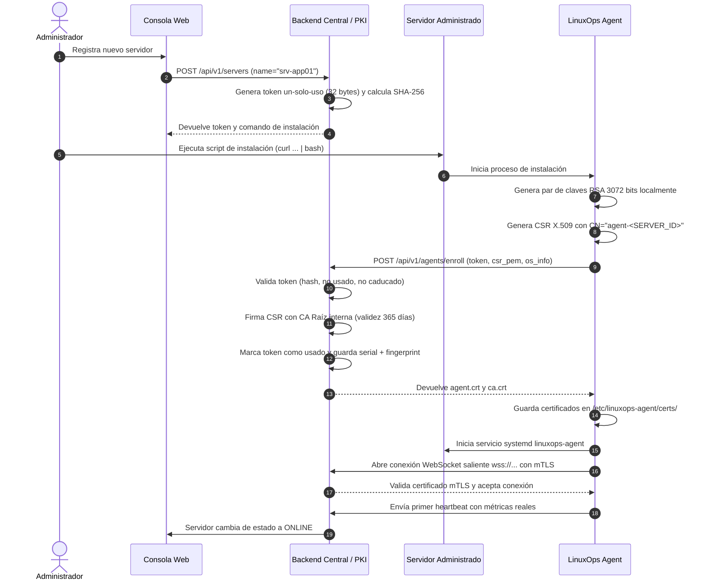

# Protocolo de Incorporación Segura y mTLS del Agente

Este documento describe el flujo criptográfico de incorporación (enrollment), autenticación mutua y ciclo de vida de los certificados en **LinuxOps Manager**.

---

## 1. Principios de Diseño
- **Claves Privadas Aisladas**: La clave privada RSA del agente se genera localmente en el servidor administrado y **nunca** se transmite a través de la red ni se expone al backend.
- **Tokens de Un Solo Uso**: El registro utiliza tokens efímeros (caducidad por defecto: 30 minutos). El backend solo almacena el hash SHA-256 del token en la base de datos.
- **Identidad mTLS Individual**: Cada agente dispone de un certificado X.509 de cliente único emitido por la CA interna de LinuxOps Manager, cuyo Common Name (CN) corresponde al identificador `agent-<SERVER_ID>`.
- **Conexión Saliente**: El agente inicia la conexión hacia el servidor central. No es necesario abrir puertos de entrada en el servidor remoto ni exponer interfaces SSH o Docker TCP.

---

## 2. Diagrama de Secuencia del Handshake

---

## 3. Revocación de Agentes

Si un servidor es retirado o comprometido, un administrador con permiso `agents:revoke` puede revocarlo desde la interfaz:

1. Se ejecuta `POST /api/v1/agents/{agent_id}/revoke`.
2. El backend marca el certificado como revocado (`is_revoked = True`) y guarda la marca de tiempo y el motivo.
3. El `AgentGateway` cierra inmediatamente la conexión WebSocket activa con código de cierre de política `1008`.
4. Si el agente intenta reconectarse, el backend rechaza la conexión durante la verificación de identidad.
5. El servidor pasa al estado **Revocado** en el inventario.

