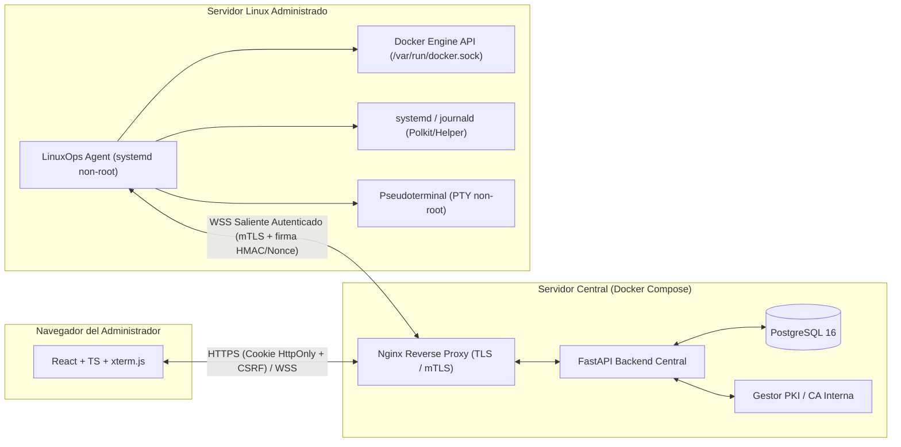

# Arquitectura Técnica y Diagnóstico Inicial — LinuxOps Manager

## 1. Informe de Diagnóstico Inicial (Fase 0)

### 1.1 Estado del Directorio de Trabajo
- **Ruta inspeccionada**: `f:\Proyectos_Dockers\LinuxOps Manager`
- **Estado**: Directorio limpio, sin archivos preexistentes, contenedores previos ni configuraciones heredadas.
- **Conflictos detectados**: Ninguno en el directorio de trabajo.
- **Acción tomada**: Diseño e inicialización desde cero siguiendo una arquitectura modular de tres componentes desacoplados (`frontend`, `backend`, `agent`) más infraestructura reproducible (`deploy`).

---

## 2. Arquitectura General del Sistema

LinuxOps Manager se compone de cuatro subsistemas principales:

1. **Frontend Web (`frontend/`)**: SPA en React 18 + TypeScript + Vite + Tailwind CSS + TanStack Query + React Router + xterm.js + Recharts/Lucide.
2. **Backend Central (`backend/`)**: API REST + WebSocket en Python 3.12 + FastAPI + SQLAlchemy 2.0 (Async/Sync) + Alembic + Pydantic v2 + Argon2id + PyOTP (MFA TOTP) + Gestión de PKI/mTLS interna.
3. **Agente Linux (`agent/`)**: Demonio systemd ligero en Python (`linuxops_agent`) con conexión saliente persistente (WebSocket sobre TLS mutuo / HTTPS mTLS), validación local de políticas, recolección de métricas (`psutil`/procfs), gestión de Docker vía SDK (`docker` python client sobre `/var/run/docker.sock`), gestión controlada de unidades `systemd` (`systemctl`/`journalctl` con lista blanca y validación estricta de nombres sin `shell=True`), y sesiones PTY aisladas con usuario no-root.
4. **Infraestructura y Proxy (`deploy/`)**: PostgreSQL 16, Backend FastAPI, Frontend y Nginx como Reverse Proxy TLS/mTLS.

---

## 3. Flujo de Comunicación y Seguridad Central ↔ Agente

### 3.1 Incorporación Segura (Enrollment)
1. Un usuario con permiso `agents:enroll` registra un nuevo servidor en el Backend (`POST /api/v1/servers`).
2. El Backend genera un **Token de Incorporación de un solo uso** (almacenado únicamente como hash SHA-256 en base de datos) con expiración corta (ej. 30 minutos).
3. En el servidor Linux destino, el administrador instala el agente y ejecuta el comando de registro proporcionando el token y una CSR (Certificate Signing Request) generada localmente (la clave privada nunca abandona el servidor Linux).
4. El Backend valida el token (no usado, no expirado), firma el certificado X.509 de cliente con la CA interna de LinuxOps Manager, registra la huella (`fingerprint` SHA-256) y el `serial_number` del certificado, y marca el token como consumido.
5. A partir de ese momento, el agente establece un túnel saliente sobre TLS mutuo (mTLS) + cabeceras de protocolo versionado (`X-LinuxOps-Protocol: 1.0`).

### 3.2 Protección contra Repetición (Anti-Replay) y Solicitudes Caducadas
Cada mensaje enviado desde el Backend hacia el Agente (y viceversa) utiliza un sobre estructurado (`ProtocolEnvelope`):
- `protocol_version`: `"1.0"`
- `request_id`: UUIDv4 único.
- `issued_at`: Timestamp UTC ISO-8601.
- `expires_at`: Timestamp UTC ISO-8601 (por defecto `issued_at + 30s`).
- `agent_id`: UUID del agente destinatario.
- `operation`: Acción enumerada explícita (ej. `docker.container.list`, `systemd.unit.restart`, `terminal.open`).
- `payload`: Datos validados con esquema estricto.
- `signature`: Firma HMAC-SHA256 con el secreto de sesión derivado durante el handshake mTLS.

El agente mantiene una ventana deslizante de `request_id` procesados en memoria para rechazar cualquier mensaje duplicado, así como solicitudes cuyo `expires_at` haya vencido o cuyo `operation` no esté en el catálogo de operaciones permitidas.

---

## 4. Modelo de Datos (PostgreSQL)

El esquema relacional incluye las siguientes entidades principales:
- `users`: Usuarios, hash Argon2id, estado MFA (`mfa_enabled`, `mfa_secret_encrypted`), bloqueo por fuerza bruta (`failed_attempts`, `locked_until`).
- `roles` y `permissions` (`role_permissions`, `user_roles`): RBAC granular con soporte para roles predefinidos (`superadmin`, `infra_admin`, `operator`, `auditor`, `readonly`) y roles personalizados.
- `resource_permissions`: Restricciones de permisos por servidor o grupo de servidores (`server_id`, `group_id`, `module`, `operation`).
- `user_sessions`: Sesiones activas identificadas por token opaco en cookie `HttpOnly`, con expiración, IP, User-Agent y revocación inmediata.
- `server_groups`: Agrupaciones por ambiente, ubicación o función.
- `servers`: Inventario de servidores Linux, metadatos de SO, kernel, arquitectura, estado calculado por heartbeat (`online`, `offline`, `degraded`, `pending_enrollment`, `revoked`), etiquetas JSONB.
- `agents`: Identidad de cada agente, versión, huella de certificado X.509, número de serie, estado de revocación (`is_revoked`, `revoked_at`, `revoked_reason`), fecha de último heartbeat.
- `enrollment_tokens`: Tokens de incorporación de un solo uso (hash SHA-256, expiración, fecha de consumo).
- `server_metrics`: Series temporales de CPU, RAM, discos, carga (`load_1`, `load_5`, `load_15`), uptime y contadores de contenedores/servicios fallidos.
- `connectivity_events`: Historial de conexiones, desconexiones y errores de latido.
- `tasks`: Tareas administrativas enviadas a los agentes, estado (`pending`, `running`, `completed`, `failed`, `timed_out`), resultado estructurado y correlación.
- `terminal_sessions`: Registro de sesiones PTY abiertas, usuario, servidor, inicio, fin, motivo de cierre y estado de revocación administrativa.
- `audit_logs`: Registro append-only con encadenamiento de hashes (`prev_hash`, `entry_hash` SHA-256) para detección de manipulación, usuario, IP, `correlation_id`, operación, recurso, resultado y duración.
- `alerts`: Alertas operativas (servidor desconectado, uso elevado de disco/CPU/RAM, servicios systemd fallidos, intento de operación no autorizada).
- `system_settings`: Configuraciones globales no secretas (umbrales de heartbeat, timeouts de sesión, políticas).

---

## 5. Decisiones de Seguridad Clave y Limitaciones Documentadas

1. **Auditoría con Verificación de Integridad (Tamper-Evident)**:
   - No se afirma que una tabla PostgreSQL sea mágicamente inmutable frente a un superusuario de base de datos comprometido. En su lugar, la aplicación utiliza un rol de base de datos sin permisos `UPDATE`/`DELETE` sobre `audit_logs` en operación normal, e implementa una cadena criptográfica SHA-256 (`prev_hash` -> `entry_hash`) verificable mediante un endpoint de auditoría y exportación externa (Syslog/SIEM).
2. **Aislamiento de Docker**:
   - El agente separa permisos de lectura (`docker:read`) y escritura (`docker:manage`, `docker:delete`). Nunca expone `/var/run/docker.sock` por TCP ni permite ejecutar contenedores arbitrarios con `--privileged` o montajes del host desde la interfaz en v1.
   - Se filtran automáticamente variables de entorno cuyos nombres contengan patrones sensibles (`PASSWORD`, `SECRET`, `TOKEN`, `KEY`, `PRIVATE`, `CREDENTIAL`, `DSN`, `AUTH`) tanto en el agente como en el backend antes de enviar `inspect` al navegador.
3. **Servicios Linux (`systemd`)**:
   - Validación estricta mediante expresión regular `^[a-zA-Z0-9@_.-]+\.service$` y ejecución mediante lista de argumentos (`subprocess.run(["systemctl", ...], shell=False)`).
   - Operaciones privilegiadas canalizadas mediante Polkit o `sudo` restringido únicamente al binario `/usr/bin/systemctl` con verbos específicos (`start`, `stop`, `restart`, `reload`).
4. **Terminal Web (PTY)**:
   - Deshabilitada por defecto; requiere permiso explícito `terminal:access` y confirmación de contraseña/MFA reciente (`step-up authentication`) para servidores de producción.
   - Se ejecuta bajo un usuario sin privilegios (`linuxops-pty` o `linuxops-agent`) sin `NOPASSWD: ALL` en sudoers.

