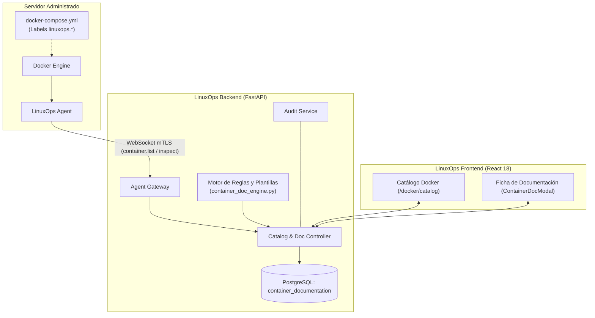

# LinuxOps Manager — Catálogo y Documentación Automática de Contenedores

Este documento detalla la arquitectura, el modelo de datos, los flujos de sincronización, el motor de inferencia de descripciones y el manual de integración del módulo de **Catálogo y Documentación de Contenedores** en LinuxOps Manager.

---

## 1. Arquitectura del Módulo

El módulo permite clasificar, documentar comprensiblemente y auditar el propósito técnico y de negocio de cada contenedor Docker administrado en la infraestructura, combinando inferencia automática, etiquetas declarativas de Docker Compose y edición administrativa manual.



### Componentes Clave:
1. **Agente Remoto:** Inspecciona contenedores y extrae metadatos técnicos y etiquetas declarativas (`attrs["Config"]["Labels"]`).
2. **Backend Central:** Procesa y fusiona los contenedores vivos con las fichas persistidas en PostgreSQL.
3. **Motor de Reglas:** Genera descripciones y propósitos inteligibles sin inspeccionar secretos ni variables de entorno.
4. **PostgreSQL (`container_documentation`):** Almacena el historial administrativo con clave de identidad duradera.
5. **Frontend:** Ofrece el Catálogo Global con filtros cruzados y la Ficha Interactiva de edición y confirmación.

---

## 2. Modelo de Datos y Clave de Identidad Duradera

### Supervivencia a la Recreación de Contenedores

En Docker, cuando un contenedor se recrea (`docker compose down && up` o actualización de imagen), su `container_id` cambia. Para **no perder la documentación**, LinuxOps Manager implementa una clave lógica duradera (`identity_key`):

$$\text{identity\_key} = \begin{cases} \text{compose:}\{\text{project}\}\text{:}\{\text{service}\} & \text{si pertenece a Docker Compose} \\ \text{name:}\{\text{container\_name}\} & \text{si es un contenedor standalone} \end{cases}$$

### Esquema de la Tabla `container_documentation`

| Campo | Tipo | Restricciones | Descripción |
| :--- | :--- | :--- | :--- |
| `id` | UUID | PK, default uuid4 | Identificador único del registro de documentación. |
| `server_id` | UUID | FK `servers.id`, ON DELETE CASCADE | Servidor Linux al que pertenece el contenedor. |
| `identity_key` | String(190) | NOT NULL, Index | Clave lógica duradera del servicio o contenedor. |
| `container_id` | String(64) | NULL, Index | Hash temporal actual reportado por Docker. |
| `container_name` | String(128) | NOT NULL | Nombre del contenedor. |
| `compose_project`| String(64) | NULL, Index | Proyecto de Docker Compose. |
| `compose_service`| String(64) | NULL, Index | Servicio dentro del proyecto Compose. |
| `image_name` | String(255) | NULL | Nombre y tag de la imagen Docker. |
| `description` | Text | NULL | Descripción detallada y comprensible. |
| `purpose` | Text | NULL | Propósito o función específica en la infraestructura. |
| `application_name`| String(128) | NULL, Index | Nombre de la aplicación o sistema mayor. |
| `category` | String(64) | NOT NULL, default 'other' | Categoría funcional (`database`, `web-application`, etc.). |
| `owner` | String(128) | NULL | Área o equipo responsable. |
| `environment` | String(32) | NOT NULL, default 'production'| `production`, `staging`, `testing`, `development`. |
| `documentation_source`| String(32) | NOT NULL, default 'auto' | Origen: `manual`, `docker_labels`, `auto`. |
| `documentation_status`| String(32) | NOT NULL, default 'undocumented' | `undocumented`, `suggested`, `documented`, `review_pending`. |
| `generated_description`| Text | NULL | Última sugerencia generada por reglas / IA. |
| `generated_purpose`| Text | NULL | Último propósito generado. |
| `generated_category`| String(64) | NULL | Última categoría sugerida. |
| `labels_snapshot`| JSONB | NOT NULL, default '{}' | Copia de etiquetas Docker encontradas. |
| `created_at` | DateTime | NOT NULL, default UTC | Fecha de creación de la ficha. |
| `updated_at` | DateTime | NOT NULL, onupdate UTC | Fecha de última modificación. |
| `updated_by` | String(64) | NULL | Nombre del usuario que realizó la modificación. |

**Restricción de unicidad:**  
`UNIQUE(server_id, identity_key)`

---

## 3. Precedencia de Fuentes de Documentación

Para proteger el trabajo administrativo y permitir al mismo tiempo automatización declarativa, se aplica la siguiente jerarquía:

```
[1] MANUAL (LinuxOps UI)
      ▲  Inmune a sobrescritura automática por el agente o Docker
      │
[2] DOCKER LABELS (Compose linuxops.*)
      ▲  Prevalece sobre inferencia si no hay edición manual previa
      │
[3] AUTO (Inferencia por Reglas / IA)
         Sugerencia inicial de arranque cuando no existen etiquetas
```

1. **`manual`:** Modificaciones realizadas por usuarios autorizados desde la interfaz web. Ningún reinicio, recreación de contenedor ni actualización de etiquetas sobrescribe estos valores.
2. **`docker_labels`:** Si la ficha no fue editada manualmente, los cambios en las etiquetas `linuxops.*` de Docker Compose se sincronizan automáticamente.
3. **`auto`:** Descripción sugerida basada en reglas para que el administrador la revise y confirme con un solo clic.

---

## 4. Etiquetas Soportadas en Docker Compose (`linuxops.*`)

Los equipos de desarrollo y DevOps pueden definir la documentación directamente en su archivo `docker-compose.yml`:

```yaml
version: '3.8'

services:
  app-backend:
    image: python:3.12-slim
    container_name: erp-backend-api
    labels:
      linuxops.managed: "true"
      linuxops.application: "ERP Corporativo"
      linuxops.category: "backend-api"
      linuxops.owner: "Equipo de Desarrollo Backend"
      linuxops.environment: "production"
      linuxops.purpose: "API REST principal para procesamiento transaccional de facturación y pagos."
      linuxops.description: "Servicio backend construido en FastAPI para la gestión operativa del ERP."

  app-db:
    image: postgres:16-alpine
    container_name: erp-database
    labels:
      linuxops.managed: "true"
      linuxops.application: "ERP Corporativo"
      linuxops.category: "database"
      linuxops.owner: "DBA / Infraestructura"
      linuxops.environment: "production"
      linuxops.purpose: "Base de datos transaccional con persistencia en volumen cifrado."
      linuxops.description: "Instancia PostgreSQL dedicada al almacenamiento transaccional del módulo financiero."
```

---

## 5. Motor de Generación Automática (Reglas y Plantillas)

Ubicado en `backend/app/services/container_doc_engine.py`, clasifica automáticamente las tecnologías más comunes:

| Categoría | Tecnologías Reconocidas por Patrón | Descripción Tipo Inferida |
| :--- | :--- | :--- |
| `database` | PostgreSQL, Timescale, MySQL, MariaDB, MongoDB, Elasticsearch, OpenSearch | "Servicio de base de datos relacional/NoSQL utilizado para almacenamiento, integridad y persistencia estructurada de datos." |
| `cache-queue` | Redis, Memcached, Dragonfly, RabbitMQ, Apache Kafka | "Servicio de almacenamiento en memoria para caché de alta velocidad o broker de mensajería asíncrona." |
| `security-proxy` | Nginx, Traefik, HAProxy, Caddy, Envoy, Vault, Keycloak, Authelia | "Servidor web HTTP, proxy inverso perimetral o gestor de identidades y secretos." |
| `web-application` | PHP-FPM, Apache HTTP Server, WordPress, Node.js, Next.js | "Entorno de ejecución y alojamiento de aplicaciones web e interfaces interactivas." |
| `backend-api` | Python (FastAPI/Django/Flask), OpenJDK/Tomcat, Express, NestJS | "Entorno de ejecución para servicios, APIs REST o microservicios de lógica de negocio." |
| `ci-cd` | Jenkins, GitLab Runner, GitHub Actions Runner, Drone, ArgoCD, Gitea | "Servidor o agente de automatización para flujos de integración y entrega continua (CI/CD)." |
| `monitoring-logging` | Prometheus, Grafana, Loki, Alertmanager, Promtail, Vector | "Componente del stack de observabilidad para recolección, métricas, logs y alertas." |
| `system-tool` | Harbor, Portainer, Watchtower, Registry, Certbot | "Herramienta de soporte operativo y gestión del ecosistema de contenedores." |
| `other` | Cualquier contenedor sin coincidencia previa | "Contenedor basado en [imagen]. Propósito específico no identificado; requiere documentación manual." |

### Salvaguardas de Seguridad Estricta:
- **No se inspeccionan variables de entorno** para inferir datos, evitando la lectura o persistencia involuntaria de secretos, contraseñas o tokens.
- **Sin comandos invasivos:** No se ejecuta ningún comando dentro del contenedor ni se expone el socket de Docker a clientes externos.
- **Preparado para IA:** El método `generate_with_ai` filtra exclusivamente metadatos seguros de catálogo (nombre, imagen, servicio, puertos, redes) antes de invocar cualquier modelo LLM futuro.

---

## 6. Endpoints de la API REST

Todos los endpoints están protegidos por autenticación JWT y RBAC:

| Método | Ruta | Permiso Requerido | Descripción |
| :--- | :--- | :--- | :--- |
| `GET` | `/api/v1/docker/documentation` | `docker:read` | Catálogo global con filtros cruzados (`server_id`, `application`, `category`, `environment`, `status`, `search`). |
| `GET` | `/api/v1/docker/documentation/summary` | `docker:read` | Resumen métrico (totales, documentados, sugeridos, distribución por ambiente y categoría). |
| `GET` | `/api/v1/servers/{server_id}/docker/containers/{container_id}/documentation` | `docker:read` | Ficha completa (metadatos técnicos vivos + documentación persistida + propuesta sugerida). |
| `PUT` | `/api/v1/servers/{server_id}/docker/containers/{container_id}/documentation` | `docker:manage` | Guardar/editar documentación manual. Registra evento en la auditoría inmutable. |
| `POST` | `/api/v1/servers/{server_id}/docker/containers/{container_id}/documentation/generate` | `docker:manage` | Recalcular propuesta de descripción bajo demanda sin sobrescribir lo guardado. |
| `POST` | `/api/v1/servers/{server_id}/docker/containers/{container_id}/documentation/confirm` | `docker:manage` | Confirmar la propuesta automática como oficial (cambia estado a `documented`). |

---

## 7. Registro de Auditoría

Cada cambio administrativo es firmado y registrado mediante `AuditService`:
- `docker.documentation.update`: Registra valores anteriores y nuevos, usuario, IP del cliente y contenedor.
- `docker.documentation.confirm`: Registra la confirmación de la propuesta automática como oficial.

---

## 8. Guía de Interfaz de Usuario (Frontend)

1. **Acceso al Catálogo Global:**
   - En la barra lateral izquierda, haz clic en **"Catálogo Docker"** (`/docker/catalog`).
   - Visualiza tarjetas resumen con métricas de cobertura de documentación.
   - Filtra por servidor, aplicación, categoría, ambiente o estado de documentación.
   - Alterna entre vista de **Tabla Detallada** y **Cuadrícula de Tarjetas**.

2. **Ficha de Documentación:**
   - Al hacer clic en un contenedor (o en el botón con ícono de destello ✨ en la lista de contenedores del servidor), se abre el modal interactivo:
     - **Pestaña "Ficha de Documentación":** Edita descripción, propósito, aplicación, categoría, responsable, ambiente y estado. Haz clic en **"Guardar Documentación"**.
     - **Pestaña "Sugerencia Automática":** Revisa la propuesta del motor de reglas. Haz clic en **"Confirmar como Oficial"** para aceptarla directamente o en **"Copiar al editor"** para afinarla.
     - **Pestaña "Detalles Técnicos":** Revisa Container ID, clave duradera `identity_key`, redes, montajes y etiquetas `linuxops.*` detectadas en Docker.
