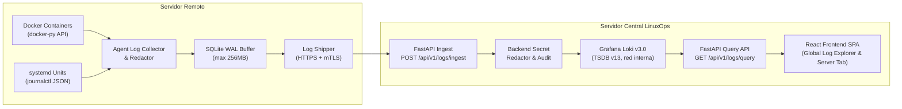

# Arquitectura del Sistema de Logs Centralizados — LinuxOps Manager

## 1. Visión General

El módulo de **Logs Centralizados** de LinuxOps Manager proporciona recolección, transporte cifrado, almacenamiento eficiente y consulta en tiempo real de registros emitidos por servidores Linux administrados (tanto contenedores Docker como servicios systemd).

El subsistema utiliza **Grafana Loki** exclusivamente como un motor interno de indexación y almacenamiento columnar de streams, sin exponer su interfaz ni requerir Grafana UI para los usuarios finales.

---

## 2. Principios de Diseño

1. **Aislamiento Interno**:
   - Loki no tiene puertos mapeados hacia el exterior (solo escucha en `linuxops-internal:3100`).
   - Ni los agentes ni el frontend interactúan directamente con Loki. Toda comunicación se canaliza a través del backend FastAPI.
2. **Desacoplamiento de Canales**:
   - El canal WebSocket existente (`/api/v1/ws/agent/{server_id}`) se mantiene reservado para heartbeats ligeros, métricas en vivo y terminal interactiva PTY.
   - El transporte masivo de logs se realiza mediante peticiones `POST /api/v1/logs/ingest` autenticadas por mTLS con certificados X.509 de cliente.
3. **Resiliencia Local (At-Least-Once Delivery)**:
   - Los logs se persisten inmediatamente en un buffer SQLite en modo WAL (`log_buffer.db`) antes de intentar la transmisión de red.
   - Si el backend o la red fallan, los registros permanecen almacenados en el servidor remoto con retroceso exponencial (`exponential backoff`) y control de cuota máxima (256 MB por defecto).
4. **Seguridad y Redacción de Secretos en Origen y Destino**:
   - Tanto el agente antes de almacenar como el backend antes de entregar a Loki ejecutan sanitización automática de claves privadas, tokens Bearer, contraseñas y credenciales de bases de datos.
5. **Control de Acceso Basado en Roles (RBAC)**:
   - Permisos granulares: `logs:read`, `logs:export`, `logs:manage`.
   - Filtrado a nivel de recurso: los operadores solo pueden visualizar logs de los servidores a los que tienen acceso concedido explícita o implícitamente en el sistema.

